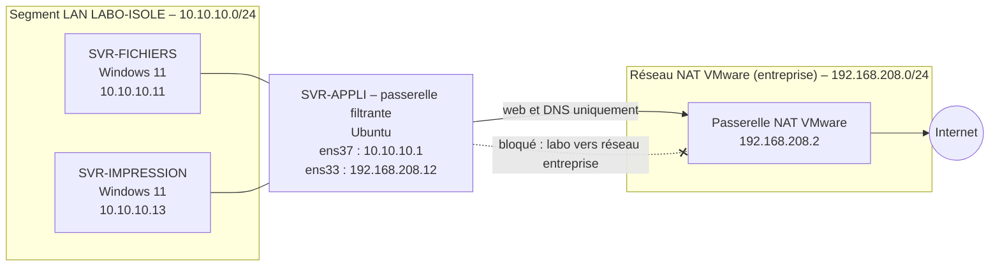

# Compte rendu – Projet 3 : Réseau virtuel isolé (labo de test)

9 octobre 2026 · Negreche Sofia · E1A

## Contexte et objectifs

Un formateur veut un labo virtuel isolé du reste du réseau, pour que les étudiants testent des configurations risquées sans danger. Le labo a été construit sur VMware Workstation, en réutilisant les VM du Projet 1.

Objectifs :

- Créer un réseau virtuel interne isolé d'Internet et du réseau physique.
- Connecter plusieurs VM à ce réseau isolé.
- Mettre en place une VM passerelle pour un accès contrôlé.
- Documenter les règles d'isolation appliquées.

**Résultat : les 4 objectifs sont atteints.** Le labo est totalement isolé sans passerelle ; avec la passerelle, il n'a accès qu'au web, et jamais au réseau de l'entreprise.

## Architecture du labo



| VM | Système | Carte réseau | Adresse IP | Passerelle | DNS |
| --- | --- | --- | --- | --- | --- |
| SVR-FICHIERS | Windows 11 | Segment LAN LABO-ISOLE | 10.10.10.11/24 | 10.10.10.1 | 1.1.1.1 |
| SVR-IMPRESSION | Windows 11 | Segment LAN LABO-ISOLE | 10.10.10.13/24 | 10.10.10.1 | 1.1.1.1 |
| SVR-APPLI (passerelle) | Ubuntu | ens37 : LABO-ISOLE | 10.10.10.1/24 | – | – |
| | | ens33 : NAT (VMnet8) | 192.168.208.12/24 | 192.168.208.2 | – |

Un **Segment LAN** VMware est un commutateur virtuel 100 % interne : pas de DHCP, pas de lien avec le PC hôte, ni avec Internet. C'est l'équivalent du « commutateur interne » demandé.

## Étape 1 : création du réseau isolé

Dans les paramètres de SVR-FICHIERS : **Carte réseau → Segment LAN → Segments LAN… → Ajouter** → nom `LABO-ISOLE`.


## Étape 2 : connexion de 2 VM au labo

SVR-FICHIERS et SVR-IMPRESSION ont leur carte réseau passée de NAT à **Segment LAN : LABO-ISOLE**.


Les IP ont été fixées manuellement (Paramètres → Réseau et Internet → Ethernet), **sans passerelle ni DNS**, avec le profil réseau « Privé ».


## Étape 3 : vérification de l'isolation

Sans passerelle, les VM du labo communiquent entre elles, mais n'atteignent ni Internet ni le réseau NAT de l'entreprise.

| Test depuis SVR-FICHIERS | Résultat | Signification |
| --- | --- | --- |
| `ping 10.10.10.13` | 4/4 reçus | Les VM du labo communiquent |
| `ping 8.8.8.8` | 100 % perdus, « défaillance générale » | Pas d'Internet |
| `ping 192.168.208.2` | 100 % perdus, « défaillance générale » | Pas d'accès au réseau NAT ni au PC hôte |

« Défaillance générale » signifie que Windows n'a aucune route pour sortir du réseau : l'isolation est totale.


## Étape 4 : VM passerelle filtrante

### Préparation de SVR-APPLI

Une 2ᵉ carte réseau a été ajoutée, reliée à LABO-ISOLE. La 1ʳᵉ reste sur le NAT.


Configuration de l'IP côté labo et activation du routage :

```bash
sudo nmcli connection add type ethernet ifname ens37 con-name LABO ipv4.method manual ipv4.addresses 10.10.10.1/24
sudo nmcli connection up LABO
echo "net.ipv4.ip_forward=1" | sudo tee /etc/sysctl.d/99-routage.conf
sudo sysctl --system
```


Le pare-feu Windows bloquait le ping venant de la passerelle (voir Difficultés). Une règle a été ajoutée sur les 2 VM du labo :

```powershell
New-NetFirewallRule -DisplayName "Ping labo" -Protocol ICMPv4 -IcmpType 8 -Direction Inbound -Action Allow -Profile Any
```


*


*

### Règles de filtrage

```bash
sudo iptables -P FORWARD DROP
sudo iptables -A FORWARD -m conntrack --ctstate ESTABLISHED,RELATED -j ACCEPT
sudo iptables -A FORWARD -i ens37 -d 192.168.208.0/24 -j DROP
sudo iptables -A FORWARD -i ens37 -o ens33 -p icmp --icmp-type echo-request -j ACCEPT
sudo iptables -A FORWARD -i ens37 -o ens33 -p udp --dport 53 -j ACCEPT
sudo iptables -A FORWARD -i ens37 -o ens33 -p tcp -m multiport --dports 53,80,443 -j ACCEPT
sudo iptables -t nat -A POSTROUTING -s 10.10.10.0/24 -o ens33 -j MASQUERADE
```


Les règles ont été rendues permanentes avec `iptables-persistent` :

```bash
sudo apt install iptables-persistent -y
sudo netfilter-persistent save
```


### Raccordement des VM du labo à la passerelle

Sur les 2 VM : passerelle `10.10.10.1`, DNS `1.1.1.1`. Un DNS public est utilisé, car le DNS de VMware (192.168.208.2) est dans le réseau de l'entreprise, volontairement bloqué.


## Règles d'isolation appliquées

| N° | Règle | Effet | Justification |
| --- | --- | --- | --- |
| – | Politique FORWARD : **DROP** | Tout ce qui n'est pas autorisé est bloqué | Principe « tout interdit sauf autorisé » |
| 1 | Connexions établies : ACCEPT | Les réponses reviennent vers le labo | Indispensable au fonctionnement |
| 2 | Labo → 192.168.208.0/24 : **DROP** | Aucun accès au réseau de l'entreprise | Protéger les vrais serveurs des tests risqués |
| 3 | Labo → Internet, ping : ACCEPT | Test de connectivité possible | Diagnostic |
| 4 | Labo → Internet, DNS UDP 53 : ACCEPT | Résolution des noms | Navigation |
| 5 | Labo → Internet, TCP 53, 80, 443 : ACCEPT | Navigation web uniquement | Accès contrôlé et limité |
| NAT | MASQUERADE 10.10.10.0/24 sur ens33 | Les adresses du labo sont cachées derrière la passerelle | Sortie vers Internet |
| – | Internet → labo | Aucune connexion entrante possible | Aucune règle ne l'autorise |

Sans la passerelle, le labo est **totalement isolé**. Avec elle, il n'a qu'un **accès contrôlé** au web.

## Étape 5 : tests de connectivité

| Test depuis SVR-FICHIERS | Attendu | Obtenu |
| --- | --- | --- |
| `ping 8.8.8.8` | Autorisé | ✅ 4/4 reçus |
| `ping google.com` | Autorisé (DNS) | ✅ 4/4 reçus |
| `ping 192.168.208.2` | Bloqué (réseau entreprise) | ✅ 100 % perdus |
| `Test-NetConnection portquiz.net -Port 80` | Autorisé | ✅ TcpTestSucceeded : True |
| `Test-NetConnection portquiz.net -Port 8080` | Bloqué | ✅ TcpTestSucceeded : False (le ping passe, la connexion non) |
| Edge sur google.com | Autorisé (HTTPS) | ✅ page affichée |


Le TTL des réponses vaut 127 au lieu de 128 : les paquets traversent bien un routeur, la passerelle. L'icône réseau de Windows reste barrée, car Windows teste la connexion avec ses propres serveurs, mais la navigation fonctionne.

Après rechargement des règles sauvegardées, les tests donnent le même résultat :


Les compteurs de la passerelle confirment le filtrage :

| Règle | Paquets | Interprétation |
| --- | --- | --- |
| Politique DROP | 25 | Trafic non autorisé bloqué (port 8080, QUIC/UDP 443…) |
| 1 · Réponses | 1 412 | Retour du trafic autorisé |
| 2 · DROP 192.168.208.0/24 | **4** | Les 4 pings vers 192.168.208.2 bloqués |
| 3 · Ping | 1 | Premier ping, les suivants passent par la règle 1 |
| 4 · DNS | 13 | Résolutions de noms |
| 5 · Web | 70 | Navigation HTTP/HTTPS |


## Difficultés rencontrées et solutions

| Problème | Cause | Solution |
| --- | --- | --- |
| La passerelle ne pouvait pas pinguer les VM du labo | Le pare-feu Windows ignorait le ping venant du nouveau réseau ; `ip neigh` montrait pourtant la VM (STALE), donc le réseau fonctionnait | Règle « Ping labo » sur les 2 VM Windows |
| Règles iptables disparues | SVR-APPLI redémarrée avant la sauvegarde ; iptables ne garde pas les règles par défaut | Règles recollées puis sauvegardées avec `iptables-persistent` |
| DNS de VMware inutilisable depuis le labo | 192.168.208.2 est dans le réseau bloqué par la règle 2 | DNS public 1.1.1.1 |


## Bilan

| Consigne | État |
| --- | --- |
| Créer un réseau virtuel interne | OK : Segment LAN LABO-ISOLE |
| Connecter au moins 2 VM | OK : SVR-FICHIERS et SVR-IMPRESSION |
| Vérifier l'absence d'accès à Internet et au réseau physique | OK : 100 % de perte sans passerelle |
| VM passerelle avec règles de filtrage | OK : SVR-APPLI, iptables, règles persistantes |
| Tester la connectivité entre les VM du labo | OK : pings entre VM et depuis la passerelle |
| Documenter le schéma et les règles d'isolation | OK : schéma et tableau des règles |

## Conclusion

Le labo permet aux étudiants de tester des configurations risquées sans danger : il est complètement séparé du réseau de l'entreprise, et l'accès à Internet passe obligatoirement par une passerelle qui n'autorise que le web. Pour un usage réel, on pourrait aller plus loin :

- couper totalement Internet pendant certains TP, en retirant simplement la passerelle des VM ;
- journaliser les paquets bloqués pour voir ce que tentent les étudiants ;
- prendre un snapshot propre de chaque VM du labo pour la remettre à zéro entre deux groupes ;
- remplacer la passerelle Ubuntu par un pare-feu dédié (pfSense, OPNsense) avec une interface graphique.