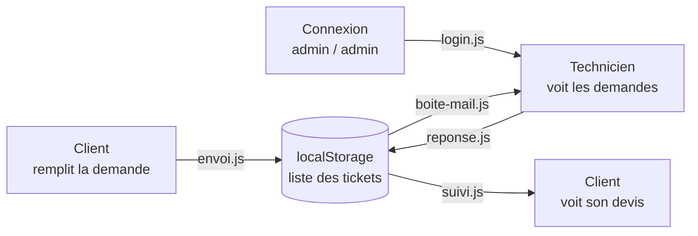

# 🖥️ Projet Web – Atelier PC : site de demande de devis

| | |
|---|---|
| **Classe** | E1A |
| **École** | Geneva Institute of Technology |
| **Cours** | HTML / CSS / JavaScript |
| **Groupe** | *(noms à compléter)* |
| **Date** | 29.10.2026 |
| **Projet** | Site local de demande de devis pour un atelier de réparation de PC |

[TOC]

---

## 1. Cadrage du projet

### Le but
Créer un site pour un atelier de réparation de PC. Le client choisit un service, remplit une demande de devis, et le technicien lui répond avec un devis (pièces, photos, prix, délai). Le client suit ensuite sa demande grâce à un numéro.

### Les contraintes
- HTML, CSS et JavaScript uniquement (pas de bibliothèque comme Bootstrap ou jQuery)
- Le site tourne **en local**, il n'est pas hébergé sur Internet
- Code simple, qu'on doit pouvoir expliquer à l'oral
- Le site doit marcher sur ordinateur et sur téléphone

### Les pages
| Page | Pour qui | Rôle |
|---|---|---|
| Accueil | Client | Présente les 3 services |
| Ajout de pièces | Client | Demande de devis pour ajouter une pièce |
| Transfert de données | Client | Demande de devis pour un transfert |
| Réparation | Client | Demande de devis pour une réparation |
| Suivre ma demande | Client | Voir le devis avec son numéro |
| Connexion | Technicien | Se connecter avant d'entrer dans l'espace technicien |
| Espace technicien (boîte mail) | Technicien | Voir toutes les demandes reçues |
| Réponse – pièces / transfert / réparation | Technicien | Remplir et envoyer le devis |

### Répartition dans le groupe
| Membre | Partie |
|---|---|
| *(nom)* | *(ex. accueil + CSS)* |
| *(nom)* | *(ex. pages de demande + envoi.js)* |
| *(nom)* | *(ex. boîte mail + réponse.js)* |
| *(nom)* | *(ex. suivi.js + tests)* |

---

## 2. Comment le site fonctionne

### Le parcours complet
1. Le **client** choisit un service sur l'accueil
2. Il remplit le formulaire et clique sur « Envoyer la demande »
3. Le site crée un **ticket** avec un numéro (ex. n° 4821) et l'enregistre dans le navigateur
4. Le **technicien** ouvre l'Espace technicien. Il doit d'abord **se connecter** (nom d'utilisateur `admin`, mot de passe `admin`). Ensuite, chaque ticket s'affiche comme un mail
5. Il clique sur « Répondre avec un devis », tape le numéro du client et remplit le devis
6. Le ticket passe de « En attente » (orange) à « Devis envoyé » (vert)
7. Le **client** va sur « Suivre ma demande », tape son numéro et voit le devis complet



### Où sont enregistrées les données ?
Dans le **localStorage** du navigateur : un petit espace de stockage que chaque navigateur met à disposition des sites. Il ne garde que du **texte**. C'est pour ça qu'on transforme nos tickets en texte avec `JSON.stringify` avant de les enregistrer, et qu'on les retransforme avec `JSON.parse` quand on les relit. [S30] [S31]

⚠️ Les données restent dans **ce navigateur, sur ce PC**. Un autre PC ou un autre navigateur ne verra pas les tickets. C'est une **simulation** de boîte mail, pas un vrai envoi de mail.

### Comment ouvrir le site
1. Ouvrir le dossier du projet dans **VS Code**
2. Installer l'extension **Live Server**
3. Clic droit sur `index.html` → **Open with Live Server**
4. Le site s'ouvre à l'adresse `http://127.0.0.1:5500`

On utilise Live Server pour que toutes les pages aient la même adresse de départ. Le localStorage est lié à cette adresse : si on ouvrait les pages en double-cliquant (`file:///`), les tickets pourraient ne pas être partagés entre les pages.

---

## 3. Organisation du dossier

```
Projet Devis Fabibou/
├── index.html                  → page d'accueil
├── LISEZMOI.md                 → mode d'emploi du projet
├── css/
│   └── style.css               → tout le style du site
├── js/
│   ├── envoi.js                → crée et enregistre le ticket du client
│   ├── login.js                → vérifie l'utilisateur et le mot de passe
│   ├── garde.js                → bloque les pages technicien si on n'est pas connecté
│   ├── reparation.js           → affiche le champ « Précisez »
│   ├── boite-mail.js           → affiche les tickets au technicien
│   ├── reponse.js              → le technicien remplit le devis
│   └── suivi.js                → le client voit son devis
├── img/
│   ├── ram.svg, ssd.svg, carte-graphique.svg, disque-externe.svg
└── pages/
    ├── ajout-pieces.html, transfert.html, reparation.html     → demandes (client)
    ├── reponse-pieces.html, reponse-transfert.html,
    │   reponse-reparation.html                                → réponses (technicien)
    ├── login.html                                             → connexion technicien
    ├── boite-mail.html                                        → espace technicien
    └── suivi.html                                             → suivi (client)
```

**Pourquoi cette organisation ?** C'est la structure demandée dans les consignes : `index.html` à la racine, puis un dossier par type de fichier (`css/`, `js/`, `img/`, `pages/`). On retrouve tout de suite où est chaque chose.

**Pourquoi un fichier JS par rôle ?** Chaque fichier fait une seule chose. C'est plus facile à lire, à corriger et à présenter.

---

## 4. 📖 Les suffixes

### 4.1 Les extensions de fichiers
L'extension (ce qu'il y a après le point) dit à l'ordinateur **quel type de fichier** c'est, et donc avec quel programme l'ouvrir.

| Extension | Nom complet | À quoi ça sert dans le projet |
|---|---|---|
| `.html` | HyperText Markup Language | Le **contenu** et la **structure** des pages (titres, textes, formulaires). [S1] |
| `.css` | Cascading Style Sheets | L'**apparence** : couleurs, tailles, mise en page, animations. [S2] |
| `.js` | JavaScript | Le **comportement** : ce qui se passe quand on clique, on tape, on envoie. [S3] |
| `.svg` | Scalable Vector Graphics | Les **images** des pièces. Une image dessinée avec du code, qui reste nette quelle que soit sa taille. [S4] |
| `.md` | Markdown | Du **texte mis en forme** simplement (`#` pour un titre, `**` pour le gras). Utilisé pour le LISEZMOI et ce HackMD. [S5] |
| `.zip` | (format compressé) | Un **dossier compressé** en un seul fichier, pour l'envoyer facilement. |

### 4.2 Les unités en CSS
Un nombre en CSS a presque toujours une unité collée derrière. [S6]

| Unité | Signification | Exemple dans le projet | Explication |
|---|---|---|---|
| `px` | pixel | `padding: 20px;` | Taille fixe à l'écran. |
| `rem` | « root em » | `font-size: 1.4rem;` | Relatif à la taille du texte de base de la page (souvent 16px). `1.4rem` ≈ 22px. Si l'utilisateur agrandit le texte de son navigateur, tout suit. |
| `%` | pourcentage | `width: 100%;` | Pourcentage de la taille du parent. `100%` = prend toute la largeur disponible. |
| `fr` | fraction | `grid-template-columns: repeat(3, 1fr);` | Unité de la Grid : une part de l'espace libre. 3 × `1fr` = 3 colonnes égales. [S17] |
| `s` | seconde | `transition: color 0.3s;` | Durée d'une animation. |
| `vw` / `vh` | largeur / hauteur de l'écran | *(non utilisé)* | 1vw = 1 % de la largeur de l'écran. |

### 4.3 Les signes au début des sélecteurs CSS
| Signe | Exemple | Veut dire |
|---|---|---|
| *(rien)* | `button { }` | Toutes les balises `<button>` |
| `.` | `.carte { }` | Tous les éléments avec `class="carte"` |
| `#` | `#liste-tickets { }` | L'élément avec `id="liste-tickets"` (un seul par page) |
| `:` | `.carte:hover { }` | Un **état** : ici, quand la souris passe dessus (pseudo-classe) [S21] |
| `@` | `@media`, `@keyframes` | Une **règle spéciale** (condition d'écran, animation) |
| `*` | `* { }` | Tous les éléments de la page |

### 4.4 Les couleurs
`#1e293b` est une couleur en **hexadécimal** : `#` + 6 caractères (2 pour le rouge, 2 pour le vert, 2 pour le bleu). `rgba(0, 0, 0, 0.1)` = noir (0,0,0) avec 10 % d'opacité, utilisé pour les ombres. [S6]

---

## 5. Le HTML expliqué

### 5.1 La structure de base d'une page
Chaque page du site commence de la même façon :

```html
<!DOCTYPE html>
<html lang="fr">
<head>
  <meta charset="UTF-8">
  <meta name="viewport" content="width=device-width, initial-scale=1.0">
  <title>Atelier PC – Accueil</title>
  <link rel="stylesheet" href="css/style.css">
</head>
<body>
  ...
</body>
</html>
```

| Ligne | Explication |
|---|---|
| `<!DOCTYPE html>` | Dit au navigateur que c'est du HTML moderne (HTML5). |
| `<html lang="fr">` | Début de la page. `lang="fr"` indique la langue : utile pour les lecteurs d'écran et la traduction automatique. |
| `<head>` | Partie invisible : réglages de la page. |
| `<meta charset="UTF-8">` | Encodage des caractères : permet d'afficher les accents (é, à, ç). |
| `<meta name="viewport" ...>` | **Indispensable pour le mobile** : la page prend la largeur réelle de l'écran du téléphone. Sans ça, le téléphone affiche une version PC rétrécie et les `@media` ne marchent pas. [S11] |
| `<title>` | Le texte affiché dans l'onglet du navigateur. |
| `<link rel="stylesheet" href="...">` | Relie la page à la feuille de style CSS. |
| `<body>` | Partie visible de la page. |

Dans les pages du dossier `pages/`, les chemins commencent par `../` (ex. `../css/style.css`). `../` veut dire **« remonter d'un dossier »** : depuis `pages/`, on remonte à la racine du projet pour trouver `css/`.

### 5.2 Les balises utilisées
| Balise | Rôle | Où dans le projet |
|---|---|---|
| `<header>` | En-tête de la page | Logo + menu, en haut de chaque page [S7] |
| `<nav>` | Menu de navigation | Liens Accueil / Suivre / Espace technicien |
| `<main>` | Contenu principal (un seul par page) | Tout le contenu central |
| `<footer>` | Pied de page | Mention du projet en bas |
| `<section>` | Une partie de la page avec un thème | « Nos services » sur l'accueil |
| `<article>` | Un bloc qui a du sens tout seul | Chaque mail dans la boîte mail (créé en JS) |
| `<div>` | Boîte sans signification, pour regrouper | Grille des cartes, zone du champ « Précisez » |
| `<h1>` à `<h3>` | Titres (h1 = le plus important) | Un seul `<h1>` par page |
| `<p>` | Paragraphe | Textes |
| `<a href="...">` | Lien vers une autre page | Menu, cartes de services |
| `<span>` | Petit morceau de texte sans signification | Icônes, total du devis |
| `<strong>` | Texte important (en gras) | « De : », « PC : » dans les mails |
| `` | Image | Photos des pièces (créées en JS) |
| `<table>`, `<tr>`, `<td>` | Tableau, ligne, case | Tableau des prix sur la page de suivi |
| `<form>` | Formulaire | Toutes les pages de demande et de réponse [S8] |
| `<label>` | Texte qui décrit un champ | Au-dessus de chaque champ [S9] |
| `<input>` | Champ de saisie | Nom, email, prix, photos… |
| `<select>` + `<option>` | Liste déroulante + ses choix | Pièce souhaitée, symptôme, délai |
| `<textarea>` | Grande zone de texte | Description du problème, message |
| `<button>` | Bouton | Envoyer, Afficher la demande |
| `<script src="..." defer>` | Charge un fichier JavaScript | Dans le `<head>` des pages |

**Pourquoi `<header>`, `<nav>`, `<main>`… et pas que des `<div>` ?** Ce sont des balises **sémantiques** : elles disent ce que contient chaque zone. Les lecteurs d'écran et les moteurs de recherche comprennent mieux la page. [S7]

### 5.3 Les attributs utilisés
Un attribut est une information ajoutée dans une balise : `<input type="email">`.

| Attribut | Explication |
|---|---|
| `id="nom"` | Nom **unique** d'un élément. Sert au JS (`#nom`) et au `<label for>`. |
| `class="carte"` | Nom de groupe, peut être utilisé plusieurs fois. Sert au CSS (`.carte`). |
| `for="nom"` (sur `<label>`) | Relie le label au champ qui a `id="nom"`. Cliquer sur le texte active le champ, et les lecteurs d'écran lisent le label. [S9] |
| `type="text"` / `"email"` / `"number"` / `"file"` / `"hidden"` / `"password"` | Type de champ. `email` vérifie qu'il y a un @, `number` n'accepte que des chiffres, `file` permet de choisir un fichier, `hidden` est invisible, `password` cache les caractères tapés par des points. [S10] [S61] |
| `autocomplete="username"` / `"current-password"` | Aide le navigateur (et les gestionnaires de mots de passe) à remplir le bon champ. [S62] |
| `required` | Champ **obligatoire** : le formulaire ne part pas s'il est vide. [S12] |
| `placeholder="ex. HP Pavilion 15"` | Texte d'exemple grisé dans le champ vide. |
| `maxlength="500"` | Nombre maximum de caractères. |
| `min="0"`, `max="9999"`, `step="0.05"` | Valeurs minimum/maximum et pas d'un champ nombre. `step="0.05"` = on avance de 5 centimes. |
| `rows="5"` | Hauteur d'un `<textarea>` en lignes. |
| `value="Réparation"` | Valeur d'un champ (ici d'un champ caché). |
| `accept="image/*"` | Le champ fichier n'accepte que des images. |
| `multiple` | On peut choisir plusieurs fichiers d'un coup. |
| `href="..."` | Adresse du lien. |
| `src="..."` | Adresse du fichier (image ou script). |
| `alt="..."` | Texte qui remplace l'image (lu par les lecteurs d'écran). |
| `defer` | Le script se lance seulement **quand toute la page est chargée**. Sinon le JS chercherait des éléments qui n'existent pas encore. [S25] |
| `aria-hidden="true"` | Cache un élément aux lecteurs d'écran (les emojis décoratifs). |
| `aria-live="polite"` | Le lecteur d'écran lit le message quand il apparaît. [S14] |
| `lang="fr"` | Langue de la page. |

### 5.4 Exemple commenté : un champ de formulaire
```html
<label for="email">Email</label>
<input type="email" id="email" required>
```
- `<label for="email">` : le texte « Email », relié au champ qui a `id="email"`
- `type="email"` : le navigateur vérifie tout seul qu'il y a un @ et un domaine
- `required` : impossible d'envoyer si c'est vide

Tout ça, c'est de la **validation native** : le navigateur vérifie le formulaire sans une ligne de JavaScript. [S13]

### 5.5 Le champ caché
```html
<input type="hidden" id="service" value="Réparation">
```
Le client ne le voit pas, mais le JS le lit pour savoir de quel service vient la demande. Chaque page de demande a le sien.

---

## 6. Le CSS expliqué

### 6.1 Comment s'écrit une règle CSS
```css
.carte {
  padding: 25px;
  background-color: white;
}
```
- `.carte` = le **sélecteur** : à qui on applique le style
- `padding` = la **propriété** : ce qu'on change
- `25px` = la **valeur**
- `;` termine chaque ligne, `{ }` entourent le bloc

### 6.2 Les propriétés utilisées
| Propriété | Explication |
|---|---|
| `box-sizing: border-box` | La largeur d'un élément inclut sa marge intérieure et sa bordure. Évite que les champs dépassent. [S15] |
| `margin` | Espace **à l'extérieur** de l'élément. `margin: 0 auto` = centré horizontalement. |
| `padding` | Espace **à l'intérieur** de l'élément, entre le bord et le contenu. |
| `max-width: 900px` | Largeur maximum : sur grand écran, le contenu ne s'étale pas trop. |
| `width` / `height` | Largeur / hauteur. |
| `background-color` | Couleur de fond. |
| `color` | Couleur du texte. |
| `font-family` | Police d'écriture. |
| `font-size` | Taille du texte. |
| `font-weight: bold` | Texte en gras. |
| `line-height` | Hauteur des lignes de texte (lisibilité). |
| `text-align` | Alignement du texte (left, center, right). |
| `text-decoration: none` | Enlève le soulignement des liens. |
| `border` / `border-left` | Bordure (épaisseur, style, couleur). |
| `border-radius` | Coins arrondis. |
| `box-shadow` | Ombre portée sous l'élément. |
| `outline` | Contour quand on arrive sur un élément au clavier (accessibilité). |
| `cursor: pointer` | La souris devient une main sur les boutons. |
| `display` | Comment l'élément s'affiche : `block`, `flex`, `grid`, `none` (caché). |
| `object-fit: cover` | L'image remplit sa case sans être déformée (elle est recadrée). |
| `border-collapse: collapse` | Une seule bordure entre les cases d'un tableau. |
| `transform` | Déplacer (`translateY`), agrandir/rétrécir (`scale`) un élément. [S20] |
| `opacity` | Transparence de 0 (invisible) à 1 (visible). |

### 6.3 Flexbox : aligner sur une ligne ou une colonne
Flexbox range des éléments **sur une seule dimension** : une ligne ou une colonne. [S16]

```css
header {
  display: flex;                    /* active Flexbox */
  justify-content: space-between;   /* logo à gauche, menu à droite */
  align-items: center;              /* centré verticalement */
  flex-wrap: wrap;                  /* passe à la ligne si pas assez de place */
  gap: 10px;                        /* espace entre les éléments */
}
```
| Propriété | Explication |
|---|---|
| `display: flex` | Les enfants directs se mettent en ligne. |
| `flex-direction: column` | Les enfants s'empilent en colonne (utilisé pour les formulaires). |
| `justify-content` | Répartition sur l'axe principal (`space-between`, `center`). |
| `align-items` | Alignement sur l'autre axe (`center`). |
| `flex-wrap: wrap` | Autorise le passage à la ligne. |
| `gap` | Espace entre les éléments. |

**Utilisé pour :** l'en-tête, le menu, les formulaires, la liste des mails.

### 6.4 Grid : une grille en lignes et colonnes
Grid range des éléments **sur deux dimensions** : lignes et colonnes en même temps. [S17] [S18]

```css
.grille {
  display: grid;
  grid-template-columns: repeat(3, 1fr);   /* 3 colonnes de même largeur */
  gap: 20px;
}
```
| Propriété | Explication |
|---|---|
| `display: grid` | Active la grille. |
| `grid-template-columns` | Définit les colonnes. `repeat(3, 1fr)` = 3 colonnes égales. |
| `grid-row: span 2` | L'élément prend 2 lignes de hauteur (l'icône des cartes sur mobile). |

**Utilisé pour :** les 3 cartes de services, les photos des pièces sur mobile, la disposition icône/texte des cartes sur mobile.

**Flexbox ou Grid ?** Flexbox pour une seule ligne ou une seule colonne (menu, formulaire). Grid quand on veut un vrai quadrillage (les cartes). [S19]

### 6.5 Les animations
Deux outils CSS :
- **`transition`** : un changement **en douceur** entre deux états (ex. normal → survolé). [S20]
- **`@keyframes`** : une animation **complète** qu'on décrit de `from` (début) à `to` (fin). [S22]

```css
/* On décrit l'animation une fois… */
@keyframes apparition {
  from { opacity: 0; transform: translateY(20px); }   /* invisible, 20px plus bas */
  to   { opacity: 1; transform: translateY(0); }      /* visible, à sa place */
}

/* …puis on l'utilise */
main {
  animation: apparition 0.6s ease-out;
}
```

| Animation | Technique | Où |
|---|---|---|
| Fondu à l'ouverture de chaque page | `@keyframes apparition` | Toutes les pages |
| Les cartes montent au survol | `transition` + `:hover` | Accueil |
| Les liens du menu s'éclaircissent | `transition` + `:hover` | Menu |
| Le bouton s'enfonce au clic | `:active` + `transform: scale(0.97)` | Tous les boutons |
| Le champ « Précisez » apparaît | JS ajoute `.visible` → `@keyframes` | Réparation |
| Le message de confirmation glisse | JS ajoute `.visible` → `@keyframes glissement` | Pages de demande et de réponse |
| Les photos apparaissent en fondu | `@keyframes apparition` | Pages de réponse, suivi |
| La bordure du mail passe au vert | JS ajoute `.repondu` → `transition` | Boîte mail |
| Le formulaire « secoue » si le mot de passe est faux | JS ajoute `.secoue` → `@keyframes secousse` (gauche-droite-gauche) | Connexion |

**Le principe à retenir :** le **JavaScript ajoute une classe**, le **CSS anime**. Le JS ne fait jamais l'animation lui-même.

**Les pseudo-classes utilisées :**
| Pseudo-classe | Quand elle s'applique |
|---|---|
| `:hover` | La souris est au-dessus [S21] |
| `:active` | Pendant le clic |
| `:focus` | On est dans le champ (clic ou Tab) |
| `:focus-visible` | On arrive sur l'élément **au clavier** |
| `:last-child` | Le dernier élément d'un groupe (la colonne des prix) |

### 6.6 La version mobile (responsive)
Une **media query** (`@media`) applique des règles **seulement si une condition est vraie**, par exemple « l'écran fait moins de 700px de large ». [S23] [S24]

```css
@media (max-width: 700px) {
  .grille {
    grid-template-columns: 1fr;   /* 1 seule colonne au lieu de 3 */
  }
}
```

| Taille d'écran | Ce qui change |
|---|---|
| **Moins de 700px** (téléphone, petite tablette) | Cartes sur 1 colonne avec l'icône à gauche ; menu en « pastilles » ; titres plus petits ; boutons de 44px de haut minimum ; photos 3 par ligne ; moins de marges ; pas d'effet de survol |
| **Moins de 340px** (très petits téléphones) | Texte un peu plus petit, photos 2 par ligne |

**Pourquoi 44px pour les boutons ?** C'est la taille minimum recommandée par les règles d'accessibilité du W3C pour qu'une zone soit facile à toucher avec le doigt. [S27]

**Pourquoi les règles mobiles sont à la fin du fichier ?** En CSS, quand deux règles disent le contraire, **la dernière gagne** (c'est la « cascade »). En les mettant à la fin, elles remplacent les règles du dessus sur petit écran.

**Pour tester :** F12 → Ctrl + Shift + M → choisir un téléphone.

---

## 7. Le JavaScript expliqué

### 7.1 Le vocabulaire de base
| Mot / signe | Ce que ça fait | Exemple du projet |
|---|---|---|
| `//` | **Commentaire** : texte ignoré par l'ordinateur, pour expliquer le code. | `// On vide le formulaire` |
| `const` | Crée une **variable qu'on ne réassigne pas**. On l'utilise pour les éléments de la page qu'on récupère une fois. Attention : si c'est une liste ou un objet, son **contenu** peut quand même changer. [S28] | `const formulaire = document.querySelector("#form-devis");` |
| `let` | Crée une variable **qui peut changer** de valeur. [S29] | `let details = ...;` puis `details = details + " : " + ...;` |
| `function` | Crée une **fonction** : un bloc de code avec un nom, qu'on peut réutiliser. [S32] | `function calculerTotal() { ... }` |
| `return` | Renvoie un résultat et **arrête** la fonction. | `return;` (on s'arrête si le numéro est invalide) |
| `if (...) { } else { }` | **Condition** : si c'est vrai, fais ceci, sinon fais cela. [S33] | `if (ticket === undefined) { ... }` |
| `else if` | Une autre condition à tester si la première est fausse. | Les 3 cas de la page de suivi |
| `===` | **Égal strictement** (même valeur et même type). [S34] | `choix.value === "Autre"` |
| `!==` | **Différent de**. | `precision !== null` |
| `&&` | **ET** : vrai seulement si les deux conditions sont vraies. [S63] | Utilisateur juste **et** mot de passe juste |
| `\|\|` | **OU** : prend la valeur de gauche, ou celle de droite si la gauche est vide. [S35] | `JSON.parse(...) \|\| []` → la liste, ou une liste vide |
| `!` | **NON** : inverse vrai/faux. `!ticket.devis` = « il n'y a pas de devis ». [S36] | `if (!ticket.devis)` |
| `+` | Addition de nombres **ou** collage de textes. | `"Demande n° " + ticket.numero` |
| `{ clé: valeur }` | Un **objet** : regroupe plusieurs infos sous un même nom. [S37] | `const ticket = { numero: 4821, nom: "Dupont" }` |
| `ticket.nom` | Lire une info d'un objet (avec un point). | `ticket.service` |
| `[ ]` | Un **tableau** (une liste). | `const photos = [];` |
| `tickets[index]` | Le ticket à la position `index` dans la liste (on compte à partir de 0). | `tickets[index].statut` |
| `null` | « Vide exprès ». | `devis: null` (pas encore de devis) |
| `undefined` | « N'existe pas / pas trouvé ». | `find` renvoie `undefined` s'il ne trouve rien |
| `` `texte ${variable}` `` | **Template literal** : un texte entre accents graves où on insère des variables avec `${ }`. Permet aussi d'écrire sur plusieurs lignes. [S38] | `` `<h2>Ticket n° ${ticket.numero}</h2>` `` |

### 7.2 Les boucles
| Code | Ce que ça fait | Exemple |
|---|---|---|
| `for (const fichier of liste) { }` | Répète le bloc **pour chaque élément** de la liste. [S39] | Pour chaque photo choisie, on crée une image |
| `liste.forEach(function (ticket, index) { })` | Pareil, mais avec une fonction. On reçoit aussi la **position** (`index`). [S40] | Pour chaque ticket, on crée un mail |

### 7.3 Agir sur la page (le DOM)
Le **DOM** (Document Object Model) est la page HTML vue par le JavaScript, comme un arbre d'éléments qu'il peut lire et modifier. [S41]

| Code | Ce que ça fait | Exemple |
|---|---|---|
| `document` | La page entière. | |
| `document.querySelector("#id")` | **Trouve** le premier élément qui correspond au sélecteur (comme en CSS). Renvoie `null` s'il ne trouve rien. [S42] | `document.querySelector("#email")` |
| `.value` | Ce qui est **écrit ou choisi** dans un champ. Toujours du **texte**. | `champNumero.value` |
| `.textContent` | **Remplace le texte** d'un élément. [S43] | `message.textContent = "✅ Demande envoyée"` |
| `.innerHTML` | **Remplace le contenu HTML** d'un élément (on peut y mettre des balises). [S44] | Construire un mail complet |
| `.classList.add("x")` | **Ajoute** une classe CSS. [S45] | `message.classList.add("visible")` → déclenche l'animation |
| `.classList.remove("x")` | **Enlève** une classe CSS. | Recacher le champ « Précisez » |
| `document.createElement("article")` | **Crée** une nouvelle balise (pas encore visible). [S46] | Un mail, une image |
| `.appendChild(element)` | **Ajoute** l'élément créé dans la page (il devient visible). [S47] | `liste.appendChild(carte)` |
| `.required = true` | Rend un champ obligatoire depuis le JS. | Champ « Précisez » |
| `.files` | La liste des fichiers choisis dans un champ `type="file"`. [S48] | Les photos |
| `.reset()` | Vide tout le formulaire. | Après l'envoi |
| `location.reload()` | Recharge la page. [S49] | Après « Vider la boîte mail » |
| `location.href = "page.html"` | **Va sur une autre page**. [S64] | Après une connexion réussie |
| `location.replace("page.html")` | Va sur une autre page **sans garder l'ancienne dans l'historique** : le bouton « Retour » ne ramène pas sur la page protégée. [S64] | `garde.js` |
| `setTimeout(fonction, 10)` | Lance une fonction **après un délai** en millisecondes. [S65] | Relancer l'animation de secousse |

### 7.4 Les événements
Un **événement**, c'est quelque chose qui se passe sur la page : un clic, une lettre tapée, un formulaire envoyé.

```js
bouton.addEventListener("click", function () {
  // ce code s'exécute à chaque clic
});
```
`addEventListener` = « **écoute** cet événement, et quand il arrive, lance cette fonction ». [S50]

| Événement | Quand il se déclenche | Utilisé pour |
|---|---|---|
| `"submit"` | On envoie un formulaire (seulement si tous les champs `required` sont remplis) | Créer le ticket, enregistrer le devis, chercher un ticket |
| `"click"` | On clique | « Afficher la demande », « Vider la boîte mail » |
| `"input"` | À chaque lettre ou chiffre tapé | Compteur de caractères, total en direct |
| `"change"` | On change de choix dans une liste ou on choisit un fichier | Champ « Précisez », aperçu des photos |

**`event.preventDefault()`** : par défaut, un formulaire envoyé **recharge la page**. Cette ligne l'en empêche, pour que notre JavaScript garde la main. [S51]

### 7.5 Le stockage (localStorage et JSON)
| Code | Ce que ça fait |
|---|---|
| `localStorage.setItem("tickets", texte)` | **Enregistre** un texte sous le nom « tickets ». [S30] |
| `localStorage.getItem("tickets")` | **Relit** le texte enregistré (ou `null` s'il n'y a rien). |
| `localStorage.removeItem("tickets")` | **Supprime** les tickets. |
| `JSON.stringify(liste)` | Transforme une liste/un objet **en texte**. [S31] |
| `JSON.parse(texte)` | Retransforme le texte **en liste/objet**. [S52] |
| `sessionStorage.setItem("connecte", "oui")` | Comme localStorage, mais **oublié quand on ferme l'onglet** (et un nouvel onglet doit se reconnecter). Sert à se souvenir que le technicien est connecté. [S66] |

**Pourquoi JSON ?** Le localStorage ne sait stocker que du texte. [S30] Une liste de tickets n'est pas du texte, donc on la convertit avant de l'enregistrer, puis on la reconvertit en la relisant.

La ligne qu'on retrouve dans tous les fichiers :
```js
const tickets = JSON.parse(localStorage.getItem("tickets")) || [];
```
« Lis les tickets enregistrés et retransforme-les en liste. S'il n'y en a pas encore, prends une liste vide. »

### 7.6 Les outils pour les nombres, les listes et les dates
| Code | Ce que ça fait | Exemple |
|---|---|---|
| `liste.push(element)` | **Ajoute** un élément à la fin de la liste. [S53] | `tickets.push(ticket)` |
| `liste.find(function (t) { return ...; })` | **Cherche** le premier élément qui correspond. Renvoie `undefined` s'il ne trouve rien. [S54] | Retrouver un ticket par son numéro |
| `Number("64.90")` | Transforme un **texte en nombre**. Indispensable car `.value` renvoie toujours du texte : `"30" + "64.90"` donnerait `"3064.90"` ! [S55] | Calcul du total |
| `.toFixed(2)` | Affiche un nombre avec **2 chiffres après la virgule**. [S56] | `94.9` → `"94.90"` |
| `Math.random()` | Nombre au hasard entre 0 (inclus) et 1 (exclu). [S57] | |
| `Math.floor(x)` | **Arrondit vers le bas**. [S58] | |
| `Math.floor(Math.random() * 9000) + 1000` | Nombre entier au hasard **entre 1000 et 9999** | Le numéro de ticket |
| `new Date().toLocaleString("fr-CH")` | Date et heure actuelles au format suisse. [S59] | `29.10.2026 11:48:54` |

### 7.7 Fichier par fichier

#### `envoi.js` – utilisé par les 3 pages de demande
**Rôle :** compter les caractères, puis transformer le formulaire en ticket et l'enregistrer.

1. On récupère les éléments de la page avec `querySelector`
2. **Compteur** : à chaque lettre tapée (`input`), on affiche `longueur / 500 caractères`
3. **À l'envoi** (`submit`) :
   - `event.preventDefault()` : la page ne se recharge pas
   - on lit le champ `details` et, s'il existe, le champ « Précisez »
   - on crée un objet `ticket` avec toutes les infos, un numéro au hasard, la date, le statut « En attente » et `devis: null`
   - on relit la liste des tickets, on ajoute le nouveau (`push`), on réenregistre
   - on affiche le message de confirmation (classe `visible` → animation)
   - on vide le formulaire

#### `reparation.js` – uniquement la page Réparation
**Rôle :** afficher le champ « Précisez » quand on choisit « Autre ».
- On écoute `change` sur la liste des symptômes
- Si la valeur est `"Autre"` : on ajoute la classe `visible` et le champ devient `required`
- Sinon : on recache le champ, il n'est plus obligatoire et on le vide

#### `login.js` – page de connexion
**Rôle :** vérifier le nom d'utilisateur et le mot de passe.
1. Les bons identifiants sont dans deux `const` : `"admin"` et `"admin"`
2. À l'envoi (`submit`), on compare ce qui a été tapé avec `===`, les deux conditions reliées par `&&` (ET)
3. **Juste** → on note `connecte = "oui"` dans le `sessionStorage` et on va sur la boîte mail (`location.href`)
4. **Faux** → message d'erreur rouge, le formulaire « secoue » (animation) et le mot de passe est vidé

#### `garde.js` – en haut des 4 pages technicien
**Rôle :** empêcher d'entrer dans l'espace technicien sans être connecté.
- Si le `sessionStorage` ne dit pas `connecte = "oui"`, on renvoie vers `login.html` avec `location.replace`
- Ce script est chargé **sans `defer`** : il s'exécute **avant** l'affichage de la page, donc on ne voit jamais la page protégée, même une fraction de seconde
- Le bouton « Se déconnecter » de la boîte mail efface la connexion (`sessionStorage.removeItem`) et ramène à la page de connexion

#### `boite-mail.js` – Espace technicien
**Rôle :** afficher chaque ticket comme un mail.
1. On relit les tickets. S'il n'y en a aucun, on affiche « 📭 Aucune demande »
2. `forEach` : pour chaque ticket, on crée un `<article>` et on le remplit avec `innerHTML` et un template literal
3. Pas encore de devis → bouton « Répondre avec un devis » vers la bonne page de réponse. Devis déjà envoyé → classe `repondu` (bordure verte) et rappel du total
4. On ajoute le mail dans la page avec `appendChild`
5. « Vider la boîte mail » : `removeItem` puis `location.reload()`

#### `reponse.js` – les 3 pages de réponse du technicien
**Rôle :** retrouver la demande, calculer le total, afficher les photos, enregistrer le devis.
1. **`trouverTicket()`** : une fonction qu'on écrit une fois et qu'on utilise 2 fois (bouton + envoi). Elle cherche le ticket avec `find`
2. **« Afficher la demande »** (`click`) : 3 cas → numéro inconnu ❌, mauvais service ❌ (ex. un ticket « Réparation » sur la page « Ajout de pièces »), ou affichage du résumé ✅
3. **Total** (`input`) : `Number(prix) + Number(main d'œuvre)`, affiché avec `toFixed(2)`
4. **Photos** (`change`) : pour chaque fichier choisi, on crée une `` qui pointe vers `../img/` + le nom du fichier
5. **Envoi** (`submit`) : on vérifie le ticket, on ajoute un objet `devis` dans le ticket (travaux, pièces, photos, prix, total, délai, message, date), le statut passe à « Devis envoyé », on réenregistre

**Pourquoi on garde seulement le nom des photos ?** Le localStorage ne stocke que du texte et a peu de place. Une vraie photo de téléphone est trop lourde. On garde donc le **nom du fichier**, et la photo doit se trouver dans le dossier `img/`.

#### `suivi.js` – page Suivre ma demande
**Rôle :** retrouver le ticket du client et afficher le devis.
- On transforme le numéro tapé en nombre (`Number`), puis on cherche le ticket (`find`)
- **3 cas** : numéro inconnu ❌ / pas encore de devis ⏳ / devis disponible 📩
- Si le devis existe : on construit les images des photos avec une boucle, puis on affiche tout (travail, pièces, photos, tableau des prix, délai, message)

---

## 8. Accessibilité
L'accessibilité, c'est faire en sorte que le site soit utilisable par tout le monde, y compris les personnes qui ne voient pas bien, qui utilisent un lecteur d'écran ou qui naviguent au clavier. [S26]

| Ce qu'on a fait | Pourquoi |
|---|---|
| `<label for>` sur chaque champ | Le lecteur d'écran annonce le nom du champ ; cliquer sur le texte active le champ [S9] |
| `lang="fr"` | Le lecteur d'écran lit avec la bonne prononciation |
| Balises sémantiques (`header`, `nav`, `main`, `footer`) | Navigation plus facile entre les zones de la page [S7] |
| `alt` sur les images | Description de l'image pour ceux qui ne la voient pas |
| `aria-hidden="true"` sur les emojis décoratifs | Le lecteur d'écran ne lit pas « clé à molette » inutilement |
| `aria-live="polite"` sur les messages | Les messages qui apparaissent sont lus à voix haute [S14] |
| Contour visible au clavier (`:focus-visible`) | On voit où on est quand on navigue avec Tab |
| `autocomplete` sur la connexion | Les gestionnaires de mots de passe remplissent les bons champs [S62] |
| Boutons de 44px minimum sur mobile | Faciles à toucher avec le doigt [S27] |
| Validation native (`required`, `type="email"`) | Messages d'erreur du navigateur, compris par tous [S13] |

---

## 9. Tests effectués

| Test | Résultat |
|---|---|
| Validation HTML de toutes les pages (validateur W3C Nu) [S60] | ✅ 0 erreur, 0 avertissement |
| Envoyer une demande → elle apparaît dans la boîte mail | ✅ |
| Envoyer avec un champ obligatoire vide | ✅ bloqué par le navigateur |
| Choisir « Autre » → le champ « Précisez » apparaît et devient obligatoire | ✅ |
| Compteur de caractères | ✅ |
| Numéro d'un autre service sur une page de réponse | ✅ message d'erreur |
| Total automatique (64.90 + 30 = 94.90) | ✅ |
| Aperçu des photos | ✅ |
| Le devis apparaît sur la page de suivi avec photos et tableau | ✅ |
| Statut « En attente » → « Devis envoyé » dans la boîte mail | ✅ |
| Affichage mobile (largeur iPhone 375px) : rien ne dépasse | ✅ |
| Ouvrir l'Espace technicien sans être connecté | ✅ renvoyé vers la connexion |
| Ouvrir une page de réponse sans être connecté | ✅ renvoyé vers la connexion |
| Mauvais mot de passe | ✅ message d'erreur + secousse, on reste sur la connexion |
| `admin` / `admin` | ✅ accès à la boîte mail |
| « Se déconnecter » puis retour sur la boîte mail | ✅ renvoyé vers la connexion |
| Console du navigateur (F12) : aucune erreur JavaScript | ✅ |

> **Incident :** une demande envoyée n'apparaissait pas dans l'Espace technicien.
> **Cause :** un ticket créé avec une ancienne version du site n'avait pas le champ `devis`. La boîte mail plantait sur ce ticket et n'affichait plus rien.
> **Résolution :** remplacement de `ticket.devis === null` par `!ticket.devis` (« pas de devis », qu'il soit vide ou inexistant), puis Ctrl + F5 et « Vider la boîte mail ».

| Incident | Cause | Résolution |
|---|---|---|
| Demande absente de l'Espace technicien | Ancien ticket sans champ `devis` qui faisait planter l'affichage | `!ticket.devis` + rechargement forcé + boîte vidée |

---

## 10. Limites et améliorations possibles

| Limite | Pourquoi | Amélioration possible |
|---|---|---|
| Pas de vrai mail envoyé | HTML/CSS/JS ne peuvent pas envoyer de mail seuls | Un service comme Formspree, ou un serveur (PHP, Node.js) |
| Les tickets restent dans un seul navigateur | Le localStorage est propre à chaque navigateur et à chaque adresse | Une base de données en ligne |
| La connexion n'est **pas vraiment sécurisée** | Le mot de passe est écrit dans `login.js` : n'importe qui peut le lire avec F12. Et on peut écrire soi-même `connecte = oui` dans le sessionStorage | Vérifier le mot de passe sur un **serveur**, stocké chiffré (hashé), jamais dans le code du navigateur |
| Les photos doivent être dans `img/` | Le localStorage ne peut pas stocker de grosses images | Envoi des images sur un serveur |
| Le numéro de ticket est tiré au hasard | Deux tickets pourraient avoir le même numéro (rare) | Vérifier que le numéro n'existe pas déjà |

---

## 11. Utilisation de l'IA et recherches

### Ce que l'IA a fait
- Aide pour **choisir le sujet** et vérifier qu'il colle au barème
- **Génération de la base du code** (HTML, CSS, JS), avec des commentaires en français sur chaque bloc
- Aide pour **trouver un bug** (l'incident ci-dessus) et pour la **version mobile**
- Aide pour rédiger cette documentation et trouver les sources

### Pourquoi on l'a utilisée
- À l'école, l'utilisation de l'IA est encouragée
- Gagner du temps sur la structure pour se concentrer sur la **compréhension** du code
- Le site va plus loin que ce qu'on a vu en une semaine (localStorage, JSON) : l'IA nous a aidés à l'atteindre, et on a vérifié chaque notion dans la documentation officielle (sources ci-dessous)

### Ce que nous avons fait nous-mêmes
*(à compléter par le groupe : ce que vous avez relu, compris, modifié, testé. Ex. renommage du site, choix des couleurs, tests, préparation de l'oral…)*

### Comment on a vérifié
- Chaque balise, propriété et commande expliquée dans ce document renvoie à une source officielle (MDN, W3C)
- Validation du HTML avec le validateur du W3C
- Tests manuels du parcours complet, sur ordinateur et en mode mobile

---

## 12. Sources

### Général
- **[S1]** MDN – HTML : https://developer.mozilla.org/fr/docs/Web/HTML
- **[S2]** MDN – CSS : https://developer.mozilla.org/fr/docs/Web/CSS
- **[S3]** MDN – JavaScript : https://developer.mozilla.org/fr/docs/Web/JavaScript
- **[S4]** MDN – SVG : https://developer.mozilla.org/fr/docs/Web/SVG
- **[S5]** HackMD – Guide Markdown : https://hackmd.io/s/features
- **[S6]** MDN – Valeurs et unités CSS : https://developer.mozilla.org/fr/docs/Learn_web_development/Core/Styling_basics/Values_and_units

### HTML
- **[S7]** MDN – `<header>` (balises sémantiques) : https://developer.mozilla.org/fr/docs/Web/HTML/Reference/Elements/header
- **[S8]** MDN – `<form>` : https://developer.mozilla.org/fr/docs/Web/HTML/Reference/Elements/form
- **[S9]** MDN – `<label>` : https://developer.mozilla.org/fr/docs/Web/HTML/Reference/Elements/label
- **[S10]** MDN – `<input>` : https://developer.mozilla.org/fr/docs/Web/HTML/Reference/Elements/input
- **[S11]** MDN – `<meta name="viewport">` : https://developer.mozilla.org/fr/docs/Web/HTML/Reference/Elements/meta/name/viewport
- **[S12]** MDN – Attribut `required` : https://developer.mozilla.org/fr/docs/Web/HTML/Reference/Attributes/required
- **[S13]** MDN – Validation des formulaires : https://developer.mozilla.org/fr/docs/Learn_web_development/Extensions/Forms/Form_validation
- **[S14]** MDN – `aria-live` : https://developer.mozilla.org/en-US/docs/Web/Accessibility/ARIA/Reference/Attributes/aria-live
- **[S61]** MDN – `<input type="password">` : https://developer.mozilla.org/fr/docs/Web/HTML/Reference/Elements/input/password
- **[S62]** MDN – Attribut `autocomplete` : https://developer.mozilla.org/fr/docs/Web/HTML/Reference/Attributes/autocomplete
- **[S25]** MDN – `<script>` (attribut `defer`) : https://developer.mozilla.org/fr/docs/Web/HTML/Reference/Elements/script
- W3Schools – Formulaires HTML : https://www.w3schools.com/html/html_forms.asp

### CSS
- **[S15]** MDN – `box-sizing` : https://developer.mozilla.org/fr/docs/Web/CSS/Reference/Properties/box-sizing
- **[S16]** MDN – Concepts de base de Flexbox : https://developer.mozilla.org/fr/docs/Web/CSS/Guides/Flexible_box_layout/Basic_concepts
- **[S17]** MDN – Concepts de base des grilles (Grid, unité `fr`) : https://developer.mozilla.org/fr/docs/Web/CSS/Guides/Grid_layout/Basic_concepts
- **[S18]** CSS-Tricks – A Complete Guide to CSS Grid : https://css-tricks.com/snippets/css/complete-guide-grid/
- **[S19]** MDN – Relation entre Grid et Flexbox : https://developer.mozilla.org/fr/docs/Web/CSS/Guides/Grid_layout/Relationship_with_other_layout_methods
- **[S20]** MDN – `transition` : https://developer.mozilla.org/fr/docs/Web/CSS/Reference/Properties/transition
- **[S21]** MDN – `:hover` : https://developer.mozilla.org/fr/docs/Web/CSS/Reference/Selectors/:hover
- **[S22]** MDN – `@keyframes` : https://developer.mozilla.org/fr/docs/Web/CSS/Reference/At-rules/@keyframes
- **[S23]** MDN – Media queries : https://developer.mozilla.org/fr/docs/Web/CSS/Guides/Media_queries/Using
- **[S24]** MDN – Règle `@media` : https://developer.mozilla.org/fr/docs/Web/CSS/@media
- CSS-Tricks – A Complete Guide to Flexbox : https://css-tricks.com/snippets/css/a-guide-to-flexbox/
- Flexbox Froggy (jeu pour s'entraîner) : https://flexboxfroggy.com/#fr

### Accessibilité
- **[S26]** MDN – Accessibilité : https://developer.mozilla.org/fr/docs/Web/Accessibility
- **[S27]** W3C WCAG 2.1 – Taille des cibles (44 × 44 px) : https://www.w3.org/WAI/WCAG21/Understanding/target-size.html

### JavaScript – langage
- **[S28]** MDN – `const` : https://developer.mozilla.org/fr/docs/Web/JavaScript/Reference/Statements/const
- **[S29]** MDN – `let` : https://developer.mozilla.org/fr/docs/Web/JavaScript/Reference/Statements/let
- **[S32]** MDN – `function` : https://developer.mozilla.org/fr/docs/Web/JavaScript/Reference/Statements/function
- **[S33]** MDN – `if...else` : https://developer.mozilla.org/fr/docs/Web/JavaScript/Reference/Statements/if...else
- **[S34]** MDN – Égalité stricte `===` : https://developer.mozilla.org/fr/docs/Web/JavaScript/Reference/Operators/Strict_equality
- **[S35]** MDN – OU logique `||` : https://developer.mozilla.org/fr/docs/Web/JavaScript/Reference/Operators/Logical_OR
- **[S36]** MDN – NON logique `!` : https://developer.mozilla.org/fr/docs/Web/JavaScript/Reference/Operators/Logical_NOT
- **[S37]** MDN – Les bases des objets : https://developer.mozilla.org/fr/docs/Learn_web_development/Core/Scripting/Object_basics
- **[S38]** MDN – Template literals : https://developer.mozilla.org/fr/docs/Web/JavaScript/Reference/Template_literals
- **[S39]** MDN – `for...of` : https://developer.mozilla.org/fr/docs/Web/JavaScript/Reference/Statements/for...of
- **[S40]** MDN – `forEach` : https://developer.mozilla.org/fr/docs/Web/JavaScript/Reference/Global_Objects/Array/forEach
- **[S53]** MDN – `push` : https://developer.mozilla.org/fr/docs/Web/JavaScript/Reference/Global_Objects/Array/push
- **[S54]** MDN – `find` : https://developer.mozilla.org/fr/docs/Web/JavaScript/Reference/Global_Objects/Array/find
- **[S55]** MDN – `Number` : https://developer.mozilla.org/fr/docs/Web/JavaScript/Reference/Global_Objects/Number
- **[S56]** MDN – `toFixed` : https://developer.mozilla.org/fr/docs/Web/JavaScript/Reference/Global_Objects/Number/toFixed
- **[S57]** MDN – `Math.random` : https://developer.mozilla.org/fr/docs/Web/JavaScript/Reference/Global_Objects/Math/random
- **[S58]** MDN – `Math.floor` : https://developer.mozilla.org/fr/docs/Web/JavaScript/Reference/Global_Objects/Math/floor
- **[S59]** MDN – `Date.toLocaleString` : https://developer.mozilla.org/fr/docs/Web/JavaScript/Reference/Global_Objects/Date/toLocaleString
- **[S31]** MDN – `JSON.stringify` : https://developer.mozilla.org/fr/docs/Web/JavaScript/Reference/Global_Objects/JSON/stringify
- **[S52]** MDN – `JSON.parse` : https://developer.mozilla.org/fr/docs/Web/JavaScript/Reference/Global_Objects/JSON/parse
- **[S63]** MDN – ET logique `&&` : https://developer.mozilla.org/fr/docs/Web/JavaScript/Reference/Operators/Logical_AND
- Le Tutoriel JavaScript Moderne (en français) : https://fr.javascript.info/

### JavaScript – la page (DOM) et le navigateur
- **[S30]** MDN – `localStorage` : https://developer.mozilla.org/fr/docs/Web/API/Window/localStorage
- **[S41]** MDN – Le DOM (Document Object Model) : https://developer.mozilla.org/fr/docs/Web/API/Document_Object_Model/Introduction
- **[S42]** MDN – `querySelector` : https://developer.mozilla.org/fr/docs/Web/API/Document/querySelector
- **[S43]** MDN – `textContent` : https://developer.mozilla.org/fr/docs/Web/API/Node/textContent
- **[S44]** MDN – `innerHTML` : https://developer.mozilla.org/fr/docs/Web/API/Element/innerHTML
- **[S45]** MDN – `classList` : https://developer.mozilla.org/fr/docs/Web/API/Element/classList
- **[S46]** MDN – `createElement` : https://developer.mozilla.org/fr/docs/Web/API/Document/createElement
- **[S47]** MDN – `appendChild` : https://developer.mozilla.org/fr/docs/Web/API/Node/appendChild
- **[S48]** MDN – `HTMLInputElement.files` : https://developer.mozilla.org/fr/docs/Web/API/HTMLInputElement/files
- **[S49]** MDN – `location.reload` : https://developer.mozilla.org/fr/docs/Web/API/Location/reload
- **[S50]** MDN – `addEventListener` : https://developer.mozilla.org/fr/docs/Web/API/EventTarget/addEventListener
- **[S51]** MDN – `preventDefault` : https://developer.mozilla.org/fr/docs/Web/API/Event/preventDefault
- **[S64]** MDN – `Location` (`href`, `replace`) : https://developer.mozilla.org/fr/docs/Web/API/Location
- **[S65]** MDN – `setTimeout` : https://developer.mozilla.org/fr/docs/Web/API/Window/setTimeout
- **[S66]** MDN – `sessionStorage` : https://developer.mozilla.org/fr/docs/Web/API/Window/sessionStorage

### Outils
- **[S60]** Validateur HTML du W3C : https://validator.w3.org/
- Extension Live Server pour VS Code : https://marketplace.visualstudio.com/items?itemName=ritwickdey.LiveServer

---

## 13. Plan proposé pour le PowerPoint
*(pour la personne qui fait la présentation, avec la section du HackMD où trouver le contenu)*

| Slide | Contenu | Section |
|---|---|---|
| 1 | Titre, groupe, classe E1A | En-tête |
| 2 | Le projet en une phrase + les contraintes | 1 |
| 3 | Le parcours client → technicien → client (schéma) | 2 |
| 4 | Organisation des fichiers | 3 |
| 5 | Les suffixes et unités | 4 |
| 6 | HTML : structure d'une page + formulaire avec labels | 5.1, 5.4 |
| 7 | CSS : Flexbox et Grid (avec capture des cartes) | 6.3, 6.4 |
| 8 | CSS : les animations | 6.5 |
| 9 | Version mobile (capture ordinateur vs téléphone) | 6.6 |
| 10 | JavaScript : événements + « le JS ajoute une classe, le CSS anime » | 7.4, 6.5 |
| 11 | JavaScript : localStorage et JSON | 7.5 |
| 12 | Connexion technicien (admin / admin) et ses limites | 7.7, 10 |
| 13 | Accessibilité | 8 |
| 14 | Tests + incident résolu | 9 |
| 15 | Limites et améliorations | 10 |
| 16 | Utilisation de l'IA | 11 |
| 17 | Démo en direct (avec connexion) | – |
